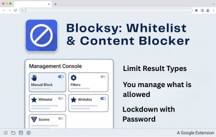

# Blocksy — Block, Filter, Whitelist, and more

Blocksy is a Chrome and Brave extension that keeps the web limited to what you choose
to see. It hides search results that match your blocked keywords and sites, stops
blocked sites from opening, filters YouTube by channel and keyword, and can lock the
browser down to an allow-list of sites. A password keeps it from being switched off on
impulse.

**[Install Blocksy from the Chrome Web Store](https://chromewebstore.google.com/detail/blocksy-block-filter-whit/hdlenebfpeejobkiacpglgeigoodolcn?hl=en-US&utm_source=ext_sidebar)**

It works in Chrome and Brave (and other Chromium browsers that use the Chrome Web
Store). Nothing leaves your browser; see [PRIVACY.md](PRIVACY.md).

## Features

- **Search result filtering.** Hides results matching your blocked keywords and sites
  on **Brave Search** and **Google**, across every result tab: **All, Images, News,
  Videos, Maps, Goggles**. Each tab type has its own switch, plus a master on/off.
  Keywords can be plain text or regex, and sites take `*` wildcards. Blocked results
  vanish outright, with no stub or "show anyway" link.
- **Site blocking.** Opening a blocked site sends the tab to a calm landing page or an
  address of your choice.
- **Sub pages and channels.** Block (or allow) one part of a site, such as a single
  YouTube channel (`youtube.com/@name`) or video, and leave the rest of it open.
- **Whitelist mode.** Flip it on and _only_ the sites you allow can be opened. Allow a
  YouTube channel and the videos you open from its page play too.
- **Streams (YouTube).** Block channels and keywords on YouTube: matching videos are
  hidden wherever they appear, and searching for or opening one sends you back to the
  home page.
- **Password lock.** Protects the popup and settings, and can guard the browser's
  extensions page so the blocker can't be switched off on impulse.
- **New tab page.** The same quiet landing page, with rotating phrases and shortcuts
  to your allowed sites.
- **A landing page you can make your own.** Edit the rotating phrases in place or
  upload your own, write custom HTML in a full-tab editor with a live preview and
  ready-made site-card layouts, and set a custom tab title and icon.
- **Backup and starter lists.** Export your rules and settings, import them from a
  file or a URL (adding to or replacing what you have), or start from a ready-made
  list.
- **Popup and diagnostics.** The popup shows what is blocked on the current search
  tab. The settings page checks private-window access and which tabs the blocker is
  running in.
- **Updates on demand.** _Check for updates_ asks the Web Store right away, and a
  downloaded update can be installed with one click.

## Getting started

1. [Install Blocksy](https://chromewebstore.google.com/detail/blocksy-block-filter-whit/hdlenebfpeejobkiacpglgeigoodolcn?hl=en-US&utm_source=ext_sidebar) and pin it to the toolbar.
2. Click the toolbar icon. The popup shows whether the current tab is a search page
   and lets you add **blocked keywords**, **blocked sites** and **blocked sub pages
   and channels** on the spot.
3. Open **Settings & diagnostics ↗** from the popup (or right-click the icon →
   **Options**) for everything else: the whitelist, Streams, the landing page, the
   password and backups.
4. To start with a ready-made list, go to **Settings → Backup → Starter lists** and
   import _Adult content starter_ or _STEM whitelist sample_.
5. If you use private windows, allow the extension there (see
   [_Private / Incognito windows_](#private--incognito-windows)). Until you do, nothing
   is blocked in them.
6. Optionally, set a **password** under **Settings → Password** and turn on **Guard the
   extensions page**.

Rules apply live, with no page reload needed.

## Opening a blocked site

Blocked sites are not only filtered out of search results — navigating to one is
intercepted too, using the same rules and the same wildcards. Three options on the
settings page:

- **Show a landing page** (default) — a quiet page with a rotating phrase.
  **Preview landing page** opens it in a tab.
- **Send me somewhere else** — any address you choose. A bare domain gets `https://`.
- **Do nothing** — filter search results only.

Two guards keep this from turning on you. **Search engines are never redirected**, so
a rule naming Brave or Google still just strips their results rather than hijacking
the search page and taking the blocker down with it. And if your chosen redirect URL
is itself blocked, the landing page is used instead of bouncing the tab between two
blocked addresses forever.

The landing page never names the site that was blocked — being told what you were
about to open is the reminder the page exists to avoid.

### Allowed sites only (whitelist)

Off by default. Switched on from the **Whitelist** toggle at the top of the settings
page, **every site not on the allowed
list is treated as blocked** and redirected as above. With the redirect set to **Do
nothing**, the landing page is used instead, since otherwise the whitelist would
have no effect.

- Entries use the blocked-sites syntax: `example.com` covers its subdomains, and `*`
  matches part of a host (`*.edu`).
- **Allowed sub pages and channels** narrows an entry to part of a site:
  `youtube.com/@name` allows that channel's pages and nothing else on YouTube. See
  [_Sub pages and channels_](#sub-pages-and-channels).
- Search engines are **not** exempt here. Add `google.com` or `search.brave.com` if you
  still want to search.
- The blocked lists still apply on top. A site on both lists is blocked.
- An empty list with the whitelist on blocks every website. Extension pages and
  `chrome://` pages are never touched.
- Only top-level navigations are checked, not iframes or the resources a page loads.
  A site that signs you in on another domain (`accounts.google.com`, for one) needs
  that domain allowed too.
- The whitelist does not hide search results; it acts when you open a site.

Export and import include the allowed list (`allowedSites`). Importing fills the list
but never switches the whitelist on.

### Custom landing HTML

**Use custom HTML** (Settings → _Opening a blocked site_) replaces the built-in
template. An element with `id="wcb-quote"` is filled with a rotating phrase (twelve
seconds each, shuffled per visit); leave it out for a static page. `<style>` works.
`<script>` does not run — assigning markup this way never executes scripts, and the
page's CSP blocks inline handlers — so treat it as styling only. Markup is capped at
6000 characters to stay inside `chrome.storage.sync`'s per-item limit; a counter shows
how much is used, and **Reset to default** starts over from the built-in template.
Switching custom HTML off keeps your markup saved for next time.

**Open editor with live preview** opens a full-tab editor (`editor.html`) with the
markup on one side and the landing page re-rendering on the other as you type. Insert
buttons add the pieces the page understands:

| Button                                      | Inserts                                                |
| ------------------------------------------- | ------------------------------------------------------ |
| _Rotating phrase_                           | the `wcb-quote` slot                                   |
| _Allowed sites (built-in cards)_            | the `wcb-allowed` slot, filled with the standard cards |
| _Image only_, _Image + title_, _Text links_ | a ready-made `<template id="wcb-site">` site layout    |

With no allowed sites yet, the preview fills site layouts with sample sites so there
is something to look at. The editor is also where **Site images** are set (below).

With the whitelist on, the landing page also lists the sites you can still go to:
in an element with `id="wcb-allowed"` if the markup has one, otherwise below it.
**Show allowed sites with whitelist mode off** lists them in custom HTML anyway, as
shortcuts, without blocking every other site.

To design the site cards yourself, add a `<template id="wcb-site">`. It is repeated
once per allowed site, in its own place, with these placeholders filled into text
and attributes:

| Placeholder   | Becomes                                                                                                                                                                                       |
| ------------- | --------------------------------------------------------------------------------------------------------------------------------------------------------------------------------------------- |
| `{{url}}`     | `https://` address of the site. Empty for a wildcard rule, and an empty `href` is dropped so the link goes inert.                                                                             |
| `{{site}}`    | The allowed-list entry as written.                                                                                                                                                            |
| `{{image}}`   | Your image for the site, set under **Site images** in the editor. Empty when none is set; an empty `src` is dropped and the stamped element gets `data-no-image`, so CSS can show a fallback. |
| `{{favicon}}` | The site's icon from the browser's favicon cache (a globe if it has never been visited).                                                                                                      |
| `{{initial}}` | First letter of the site.                                                                                                                                                                     |

```html
<ul class="sites">
  <template id="wcb-site">
    <li>
      <a href="{{url}}"> {{site}}</a>
    </li>
  </template>
</ul>
```

Each stamped element gets `data-site` (and `data-pattern` for wildcard rules) for
styling.

Site images are http(s) addresses, one per allowed site, kept in
`chrome.storage.local` (not synced, and not part of export/import) so they don't
count against the custom HTML's space. They load from any host: the whitelist only
checks pages you open, not the images a page shows. Each one does request the image
from its host whenever the landing page opens.

### Rotating phrases

The landing and new tab pages show one phrase at a time, in random order. The
built-in set is six verses from the English Standard Version, each credited "(ESV)"
(see [Scripture copyright](#scripture-copyright)).

**Rotating Phrases** (Settings → _Opening a blocked site_) lists every phrase as an
editable row — the text and an optional attribution — with **Add phrase** and a
remove button per row. Editing any of them switches to your own list, saved as you
type in `chrome.storage.local`; **Use built-in phrases** goes back. Up to 1000.

**Upload & replace** swaps the list for a file's phrases, and **Upload & append** adds
them to the end. Two formats:

- **Plain text** — one phrase per line, with an optional attribution after `—`,
  `--` or `|`, e.g. `Stay the course — Grandpa`.
- **JSON** — an array of strings or of `{ "text", "ref" }` objects, bare or under a
  `"sayings"` key.

### New tab page

The extension replaces the browser's new tab page with the landing page, minus the
"Not this way" heading, since you chose to come here. It shows the same rotating
phrases, your custom HTML if you use it, and, with the whitelist on, your allowed
sites as shortcuts.

### Browser tab title and icon

**Browser tab** on the settings page sets a custom title and favicon for the landing
and new tab pages, replacing "Not this way" and "New Tab" in the tab strip. Pick one
of the built-in icons (globe, document, spreadsheet, slides, mail, calendar, folder,
book, school, chart and more) or upload any image, which is scaled to 64 px and kept
in `chrome.storage.local`. Both are off by default.

### The permissions this needs

| Permission      | Why                                                                                                                                                  |
| --------------- | ---------------------------------------------------------------------------------------------------------------------------------------------------- |
| `storage`       | Your rules, password hash, phrases, site images and tab icon.                                                                                        |
| `webNavigation` | Sees top-level navigations so a blocked (or non-whitelisted) site can be redirected. It reads only the URL.                                          |
| `tabs`          | Reads tab URLs for the extensions-page guard (webNavigation never fires for `chrome://` pages) and finds search tabs for the popup and diagnostics.  |
| `favicon`       | Shows allowed sites' icons through `{{favicon}}` in a custom landing page, read from the browser's own icon cache, so no request leaves the browser. |

| Optional host access | Asked for one site at a time, only when you import rules from a URL (a starter list, for one), so the file can be fetched. |

There is no broad host permission granted up front. The content script only runs on
Brave Search and Google, and the navigation listener gets URLs from `webNavigation`
without needing host access.

## Settings page

Rules live on a full settings page — right-click the toolbar icon → **Options**, or
open the popup and hit **Settings & diagnostics ↗**.

The header holds two switches: **Blocking** (the master switch) and **Whitelist**,
with a rule count and the build stamp. Below them, three tabs (four with Streams on):

- **Blocked** — blocked keywords, blocked sites, and blocked sub pages and channels.
  Hidden while the whitelist is on. Those rules keep applying; the tab just steps
  aside.
- **Whitelisted** — allowed sites, and allowed sub pages and channels.
- **Settings** — a side menu of panes:
  - **Diagnostics** — see below.
  - **Search types** — a switch per result tab (All, Images, News, Videos, Maps,
    Goggles), and _Hide recommended images in the preview_.
  - **Streams** — the switch that turns on YouTube filtering and its **Streams** tab.
    See [_Streams (YouTube)_](#streams-youtube).
  - **Opening a blocked site** — the redirect choice, the landing page format,
    rotating phrases and custom HTML.
  - **Browser tab** — custom tab title and icon.
  - **Password** — the lock and the extensions-page guard.
  - **Backup** — export, import and starter lists.
  - **Updates** — _Check for updates_ and _Restart to update_.

### The popup

The toolbar popup is for quick edits on the spot. It shows whether the current tab is
a supported search page and, if so, the engine, the tab type and how many results are
hidden there (or that blocking is paused for this tab type or switched off). Below
that are the same keyword, site and sub-page lists as the **Blocked** tab. The popup
and the settings page write to the same storage and stay in sync while both are open.

### Diagnostics

The Settings tab opens with a **Diagnostics** panel that answers the questions you
cannot answer by looking at a search page:

- **Private windows** — whether the extension is actually allowed to run there,
  checked via `chrome.extension.isAllowedIncognitoAccess()`, with a button through to
  the extension's details page if it is not.
- **Runs on** — the host patterns the content script is registered for.
- **Search tabs open now** — every open tab the blocker should be running on, each
  marked _Private_ or not, reporting the tab type and how many results it has hidden,
  or _not running — reload this tab_ when no content script is present.

### Private / Incognito windows

**Extensions do not run in private windows unless you allow it, per extension.**
Until you do, nothing is blocked there at all — no code change can work around it.

Turn on **Allow in Incognito** (Chrome) or **Allow in Private** (Brave) on the
extension's details page, then open a fresh private window. In Brave, _Private window
with Tor_ is a separate mode with the same requirement.

A private search tab that does not appear under _Search tabs open now_ is itself the
answer: the extension cannot see it, so it is not blocking in it.

### Password and the extensions-page guard

**Password** (Settings tab) locks the popup and the settings page behind a prompt.
Once entered it stays unlocked for 10 minutes, until **Lock now**, or until the
browser quits. It is stored as a salted PBKDF2 hash in `chrome.storage.local`, apart
from your synced rules, so it never syncs and export / import never touch it. A
forgotten password cannot be recovered.

**Guard the extensions page** (needs a password) sends any tab opening
`chrome://extensions` — or `brave://extensions` — to the password prompt, and on to
the page once it is entered. That closes the obvious way to switch the blocker off or
remove it. Watching those tabs is why the extension asks for the `tabs` permission.

An extension cannot fully stop its own removal. Right-clicking the toolbar icon →
**Remove from Chrome** still works, as do inspecting the popup with DevTools and
deleting the browser profile. To make the extension truly impossible to disable or
remove, force-install it by policy — `ExtensionInstallForcelist` (Windows Group Policy,
a macOS configuration profile, or `/etc/opt/chrome/policies/managed/` on Linux). A
force-installed extension has no Remove or disable switch at all. Add
`DeveloperToolsAvailability` = `2` as well to close the DevTools route.

## Rules

**Keywords** match against a result's title, snippet text and URL.

| Entry       | Matches                                                     |
| ----------- | ----------------------------------------------------------- |
| `crypto`    | any result containing "crypto", case-insensitive            |
| `/\bnft\b/` | regex, delimited by slashes (`/pattern/flags`, default `i`) |

**Sites** match the hostname of any link inside a result. `example.com` also blocks
`news.example.com`. Paste a full URL and it loses its scheme and `www.`; if it has a
path (`youtube.com/@name`), it is filed under sub pages and channels instead of
blocking the whole site.

Use `*` to match part of a hostname:

| Entry         | Matches                           | Does not match     |
| ------------- | --------------------------------- | ------------------ |
| `example.com` | `example.com`, `news.example.com` | `notexample.com`   |
| `porn*`       | `pornhub.com`, `porntube.net`     | `popcorn.com`      |
| `*hub.com`    | `videohub.com`, `hub.com`         | `hub.com.evil.net` |
| `*sex*`       | `sex.com`, `mysexysite.org`       | `example.com`      |

Patterns are anchored to the whole hostname, and dots stay literal, so `news.*` will
not match `newsexample.com`. A rule of nothing but wildcards is ignored rather than
blocking every result on the page.

Watch the substring form: `*sex*` also blocks `essex.gov.uk` and `sussex.ac.uk`.
Anchor one end (`sex*`) when you mean the start of the hostname.

### Sub pages and channels

The _Blocked sub pages and channels_ list, under blocked sites, keeps the path, so a rule covers one part of a site rather than all
of it. _Allowed sub pages and channels_ does the same for the whitelist. Both are
stored in the same list as their sites; an entry with a path is shown in the sub-pages
section.

| Entry                     | Matches                                                         | Does not match                           |
| ------------------------- | --------------------------------------------------------------- | ---------------------------------------- |
| `youtube.com/@mkbhd`      | `youtube.com/@mkbhd`, `…/@mkbhd/videos`, `m.youtube.com/@mkbhd` | `youtube.com`, `youtube.com/@mkbhdclips` |
| `youtube.com/watch?v=abc` | that video, with any other parameters                           | other videos                             |

Paths and query values are compared case-insensitively. Opening a covered page —
including in-app navigation on single-page sites like YouTube, caught through
`webNavigation.onHistoryStateUpdated` — is redirected like any blocked site, and a
search result linking under the path is hidden. A video's address does not name its
channel, so `youtube.com/@name` blocks the channel's pages, not its videos.

An entry typed into a sub-pages list without a path is not added — a whole site
belongs in the sites list above it.

### Your lists stay out of sight

Every rule list is **collapsed by default, every time you open the popup or the
settings page**. You see a count — "14 keywords hidden" — and nothing else. Reading
back what you blocked is its own reminder of the thing you were avoiding, so the open
state is deliberately not remembered.

Adding never requires opening the list: the input stays available, and after a submit
you get "Added 1 keyword" or "Already on the list — nothing added" rather than an
echo of what you typed. **Show list** reveals the entries when you genuinely need to
remove one.

Rules apply live — no page reload needed. They are stored in `chrome.storage.sync`,
so they follow your profile within one browser (Chrome and Brave are separate
profiles, so each needs its own list).

### Keeping your rules

**Rebuilding and reloading the extension does not touch your rules.** `pnpm build`
replaces the contents of `dist/`, and the reload arrow on the extension card re-reads
them, but storage belongs to the extension's identity rather than to its files. For an
unpacked extension that identity is derived from the folder you loaded, so as long as
that path stays put, every rebuild keeps your keywords and sites.

[`scripts/clean.mjs`](scripts/clean.mjs) empties `dist/` in place rather than deleting
the directory, so the folder Chrome is watching never disappears mid-build.

What _does_ lose them is anything that changes that identity: removing the extension
and adding it back from a different folder, or moving the project. Two ways to be
safe:

- **Export** from the settings page before doing any of that, and **Import** after
  (see _Backup and import_ below).
- To pin the identity permanently, add a `"key"` field (a base64 SPKI public key) to
  `public/manifest.json`. The extension ID then follows the key rather than the path.
  Note that adding it _changes_ the ID once, so export your rules first.

### Backup and import

**Settings → Backup** saves and restores your setup.

- **Export rules & settings** downloads `content-blocker-rules-<date>.json`. It holds
  your keywords, blocked sites (sub pages included), allowed sites, Streams lists,
  every toggle, the custom landing page HTML, site images and labels, the tab title
  and icon, and your phrases. It **never** includes your password.
- **Import** takes that file or a plain rules file, in two modes:
  - **Import (append to existing)** adds only the rules that are new and never removes
    anything. It does not change any toggle or your custom HTML; it only fills the
    lists (and adds site images you have not set yet).
  - **Import (replace all)** makes everything exactly what the file holds, settings
    included, after a confirmation that says how many rules will go.
- **From a file** or **from a URL**. A URL must serve a JSON export, and Chrome asks
  once for permission to read that site.
- **Starter lists** are ready-made files kept in [`templates/`](templates/) and
  imported by URL with the mode chosen above: _Adult content starter_ (common adult
  keywords and sites) and _STEM whitelist sample_ (a few allowed STEM sites).

## Streams (YouTube)

Off by default. Turn on **Settings → Streams → Block streams** and a **Streams** tab
appears beside _Blocked_ and _Whitelisted_ with two lists:

- **Blocked channels** match the channel name shown on each video, ignoring case and
  spaces. Wrap an entry in slashes for a regex, e.g. `/^vmx/`.
- **Blocked keywords** match searches, the video title, and the description shown
  under search results, e.g. `/prank|reaction/i`.

On YouTube, a matching video is hidden wherever it appears: search results, the home
feed, the sidebar and the Shorts shelf. Searching for a blocked term, or opening a
matching video directly, sends you back to the YouTube home page. Searches on Vimeo
are checked too; the rest of the feature has only been tested on YouTube so far.

### Allowing a channel's videos

A video's address (`youtube.com/watch?v=…`) does not say which channel it belongs to,
so a whitelist entry such as `youtube.com/@name` could never let its own videos play.
Blocksy handles this: with the whitelist on, a video that is not otherwise allowed or
blocked is left to load just long enough for the page to show its channel. If that
channel is on the allowed list, the video plays. If not, the tab is redirected as
usual. Shorts are still blocked.

## What a blocked result looks like

Nothing. A blocked result is hidden outright, with no stub, no marker and no way to
reveal it from the page — the results around it close up as if it was never there.

Results are held back until the first scan finishes, so a blocked result is never
painted and then yanked away. Only the results area is gated, never the page, and a
1.5 second failsafe releases it no matter what — nothing can leave the page hidden.

On image tabs a second pass runs behind the selectors. When an image matches, the
image alone is **not** what gets hidden — that would leave its caption and source
link stranded in the grid. [`findTile`](src/content/collect.ts) climbs from the image
to the element holding the whole tile and removes that instead, stopping at the first
ancestor that reaches a second thumbnail or spans too many hosts, since that one is
the grid rather than the tile.

Only where no tile can be isolated at all does the image get **blanked in place**:
`src` replaced with a white pixel, painted a flat white block of the original size.
The pixels are dropped at the source rather than covered up, and the original URL is
kept in a JS map rather than a data attribute, so nothing in the markup can bring it
back. That path also re-checks images it has already blanked, because image grids
lazy-load by re-pointing `src` on existing nodes.

The only signal is the toolbar badge, which counts how many results are hidden on
the current tab. To see what was caught, turn a rule off in the popup, or use
`__wcb` in the console (below).

## Development

Blocksy is a Manifest V3 extension built with Vite, React and TypeScript, using pnpm.
Most people should install it from the
[Chrome Web Store](https://chromewebstore.google.com/detail/blocksy-block-filter-whit/hdlenebfpeejobkiacpglgeigoodolcn?hl=en-US&utm_source=ext_sidebar); the rest of this section is for working on
the code.

### Build and load

```bash
pnpm install
pnpm build          # -> dist/
```

Then in Chrome or Brave:

1. `chrome://extensions` (or `brave://extensions`)
2. Turn on **Developer mode**
3. **Load unpacked** → select the `dist/` folder

While iterating:

```bash
pnpm watch          # rebuilds dist/ on save
```

After a rebuild, hit the reload arrow on the extension card, then reload the search
tab. Popup and background changes need the card reload; content-script changes need
both.

**You never need to Load unpacked a second time.** Doing so is what puts your rules at
risk, not rebuilding — see _Keeping your rules_ below.

#### Confirming a reload took effect

The version bumps whenever the code changes, in `package.json` and
`public/manifest.json` together. The new number appears on the extension card, and
the popup and settings page both show `v1.1.2 · built Aug 31, 14:32` — the timestamp
separating builds made within the same minute. If the number has not moved after a
reload, the card is still running the old code.

**Patch numbers run 0-19; the twentieth bump rolls into the next minor**, so
`1.0.19` is followed by `1.1.0`.

Two things trigger a bump, and neither double-counts:

- `pnpm build`
- the **Stop hook** in [`.claude/settings.json`](.claude/settings.json), which fires
  when Claude Code finishes a turn

Both run `scripts/bump-version.mjs --if-changed`, which compares a fingerprint of
`src/`, `public/`, `scripts/` and the root config files against
`.claude/.version-fingerprint`. It hashes file **contents**, not timestamps, so
regenerating the icons — byte-identical output — is correctly seen as no change. A
turn that edits and then builds therefore produces exactly one bump, and a turn that
changes nothing produces none.

`pnpm bump:force` bumps unconditionally; `pnpm build:noversion` rebuilds without
touching the version; `pnpm watch` never bumps, since it rebuilds on every save.

```bash
pnpm test           # matching + result-detection unit tests (vitest/jsdom)
pnpm typecheck
```

### Packaging for the Chrome Web Store

```bash
pnpm zip            # -> release/blocksy-<version>.zip
```

[`scripts/pack.mjs`](scripts/pack.mjs) builds first, then archives the **contents** of
`dist/` — `manifest.json` has to sit at the root of the zip, and an archive holding
`dist/manifest.json` is rejected on upload. It excludes `.DS_Store` and any `.map`
file, deletes an existing archive of the same name rather than letting `zip` add to
it, and checks the layout with `unzip -l` before reporting the path.

The script is named `zip` rather than `pack` because `pnpm pack` is pnpm's own command
for building an npm tarball, and a built-in wins over a same-named script.

Because `pnpm build` bumps the version, the number in the filename always matches the
manifest inside. The Store refuses a re-upload at a version it already has, so each
submission needs a fresh build anyway. Running `node scripts/pack.mjs` directly skips
the build and fails if `dist/` has drifted from `package.json`.

Review asks you to justify each permission; the reasoning is in
[_The permissions this needs_](#the-permissions-this-needs) below, and the privacy
policy is [PRIVACY.md](PRIVACY.md). Publishing **Unlisted**
gets you an install link without the discovery-surface scrutiny of a public listing,
and can be flipped public later.

#### Updates

A Store install updates itself: upload a new `pnpm zip` build and Chrome fetches it
within a few hours, keeping every rule. **Settings → Updates** has a _Check for
updates_ button that asks the Store right away. Once a new version has downloaded,
that pane and the popup offer _Restart to update_, which reloads the extension to
install it. Without a restart, Chrome installs it the next time the extension goes
idle. An unpacked install never updates; the pane says so and explains how to update
it by hand.

`chrome://extensions` → _Pack extension_ produces a `.crx` instead, but Chrome has
blocked installing those from outside the Web Store on Windows and macOS for years.
For local use, **Load unpacked** on `dist/` is the better path.

### How results are detected

Search engines rewrite their markup constantly, so [`src/engines.ts`](src/engines.ts)
holds a deliberately redundant selector list per engine and tab type. A stale
selector costs nothing; one surviving selector keeps blocking alive.

Not every result is a link. Brave renders each image result as a `<button>` with the
thumbnail, caption and source name inside it and no anchor anywhere, so those tiles
are matched by `button.image-result` and `[data-index]`, and a result carrying no
links at all falls back to reading domains out of its visible text.

The image preview has its own strip of recommended images — `button.images-grid-image`
elements — and it mounts outside the results container, which is why image tabs set
`scanWholePage` and collect candidates from the whole document rather than `#results`.

Those thumbnails are the hard case: bare images with no caption, no link and nothing
to match a rule against. Two things address them.

**Repeats are recognised by the picture itself.** Every image inside a blocked result
is remembered by URL, plus its trailing path segment when that is long enough to be a
content hash — engines proxy the same picture at several sizes through URLs that
differ only in their size parameters. The same image reappearing anywhere on the page
is then blocked on sight, caption or not.

**The rest of the strip is removed outright**, controlled by _Hide recommended images
in the preview_ (on by default). A thumbnail that does not repeat a blocked result
cannot be judged at all, and the strip exists only to offer more pictures.

This is the one thing that hides an element without a rule matching it, so it is
scoped tightly. Brave uses the **same component class for the grid and the preview's
suggestions**, and the only thing separating them is position: anything inside the
results container is a real result and is never touched by this — it stays visible and
clickable, removable only by an actual rule match. Beyond that, the strip's container
is collapsed only when it holds the thumbnails and at most one other child; otherwise
each thumbnail goes individually, so the preview itself cannot disappear.

[`src/content/collect.ts`](src/content/collect.ts) then narrows those matches to
individual results: elements holding two or more other candidates are treated as
containers and dropped in favour of their children, nested duplicates collapse to
the outermost survivor, and anything linking to more than five distinct hosts is
skipped entirely. That last guard means a loose selector under-blocks rather than
wiping out a whole results grid.

#### Tuning selectors

If a result type stops being caught, open DevTools on the results page, switch the
console context dropdown from `top` to **Blocksy**, and inspect:

```js
__wcb.state; // engine, tab type, whether blocking is active, live counts
__wcb.candidates(); // every element treated as one result, with the facts matched
__wcb.rescan(); // re-evaluate the page from scratch
```

If `candidates()` is empty or returns the whole results container, add a selector to
the relevant list in `src/engines.ts`.

### Layout

```
public/manifest.json     MV3 manifest (also public/icons, generated at build time)
src/engines.ts           per-engine URL detection + result selectors
src/matcher.ts           keyword/regex/site rule compilation and matching
src/storage.ts           chrome.storage.sync wrapper with defaults + change events
src/content/             content script: scan, block, observe, report
src/**/*.test.ts         unit tests for the matching and detection heuristics
src/ui/                  controls shared by both pages + the settings hook
src/ui.css               shared design tokens and control styles
src/popup/               compact popup (index.html)
src/options/             full settings page + diagnostics (options.html)
src/blocked/             landing page shown instead of a blocked site (blocked.html)
newtab.html              new tab override, reusing src/blocked/ as a home page
src/editor/              full-tab landing HTML editor with live preview (editor.html)
src/landing.ts           default template + the phrases it rotates
src/sayings.ts           parsing and storage for your own phrases
src/siteImages.ts        per-site images for custom landing layouts
src/tabIcon.ts           custom tab title and favicon (+ tabIconPresets.ts)
src/lock.ts              password hash, unlock window, extensions-page check
src/redirect.ts          where a blocked navigation is sent, and when not to
src/background.ts        service worker: badge counts, redirects, extensions guard
src/stream/              YouTube/Vimeo content script for Streams (stream.js)
src/update.ts            Web Store update check and "Restart to update"
scripts/generate-icons.mjs  renders the toolbar PNGs, no image dependencies
templates/               starter lists offered under Settings → Backup
```

Three Vite builds produce `dist/`: [`vite.config.ts`](vite.config.ts) for the popup,
settings page and service worker (ES modules, with React shared in one chunk across
both pages), and [`vite.content.config.ts`](vite.content.config.ts) for the content
script, which MV3 requires to be a single non-module IIFE, and
[`vite.stream.config.ts`](vite.stream.config.ts) builds the Streams content script the
same way.

### Adding another engine or domain

Google is matched on `https://*.google.com/*` only. For a country domain
(`google.co.uk`, …) add it to `content_scripts.matches` in
`public/manifest.json`; the engine's own `matches` test already accepts any
`google.*` host. A different search engine is a new entry in `ENGINES`.

## Known limits

- Maps results on both engines live inside an embedded map UI; blocking there is
  best-effort and works on the list rail, not on map pins.
- Google has no Goggles tab, so that switch only affects Brave.
- `chrome.storage.sync` caps an item at ~8 KB — a few hundred rules.

## Scripture copyright

Scripture quotations are from the ESV® Bible (The Holy Bible, English Standard
Version®), © 2001 by Crossway, a publishing ministry of Good News Publishers. Used by
permission. All rights reserved.
